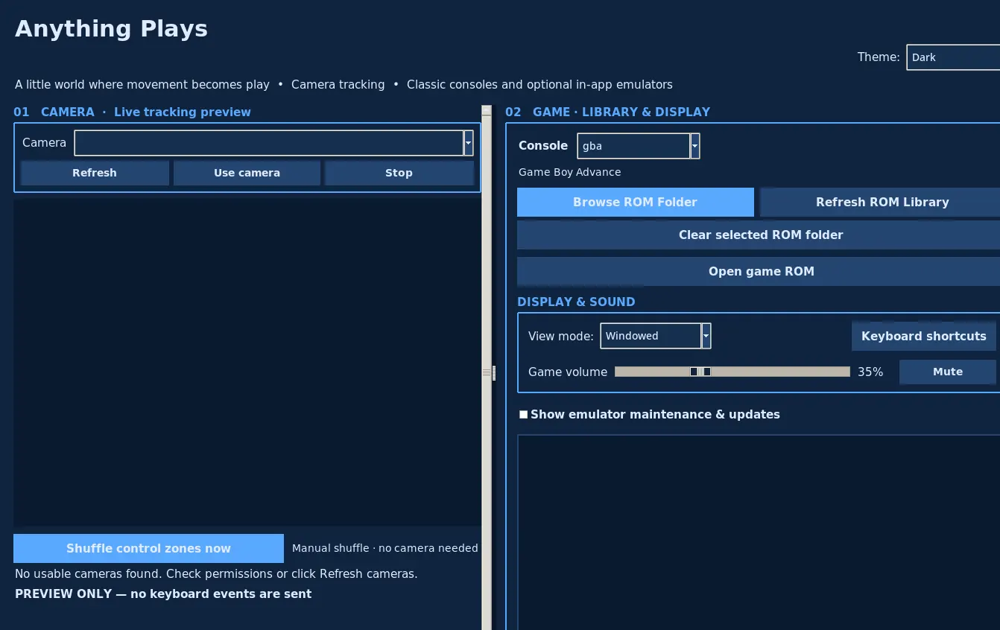
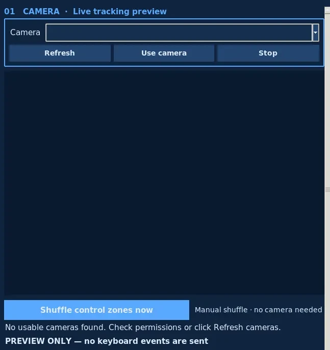
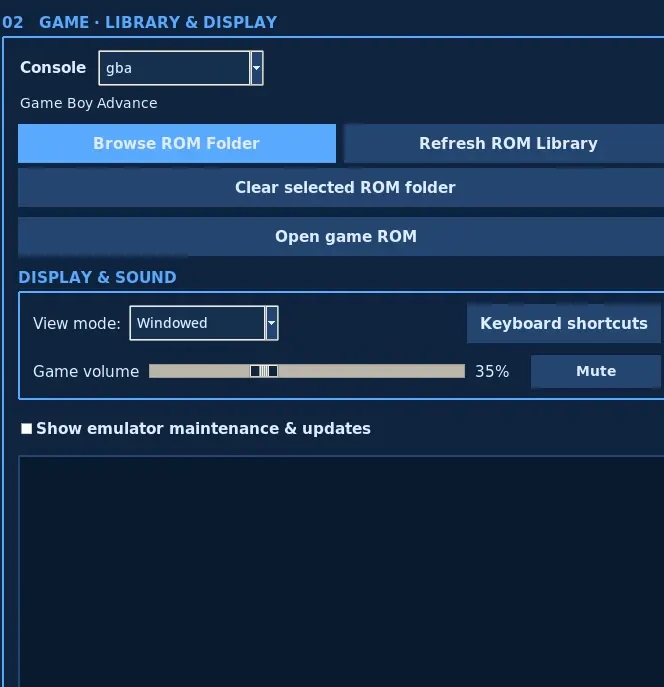

<div align="center">
  

  # Anything Plays

  **If it moves, it plays.**

  Turn everyday movement into a controller for classic video games.

  **Camera-powered play · 18 console profiles · Windows, macOS & Linux**

  [Download 3.0](https://github.com/MasynNay/anything-plays/releases/latest) ·
  [Screenshots](#screenshots) ·
  [Get started](#get-started) ·
  [How it works](#how-it-works) ·
  [Roadmap](ROADMAP.md) ·
  [Report an issue](https://github.com/MasynNay/anything-plays/issues)
</div>

---

## Screenshots

### The Anything Plays 3.0 desktop application

[](docs/screenshots/current/desktop-overview.png)

<sub>Actual packaged 3.0 desktop application on Linux. No webcam or game ROM was connected for this capture, so the video panels are blank. Select the image for the full-size version.</sub>

### Camera controls and game library

<table>
  <tr>
    <td width="50%" align="center"><a href="docs/screenshots/current/camera-controls.png"></a></td>
    <td width="50%" align="center"><a href="docs/screenshots/current/game-library-and-audio.png"></a></td>
  </tr>
  <tr>
    <td align="center"><sub>Camera setup and control zones</sub></td>
    <td align="center"><sub>Console, ROM library and sound</sub></td>
  </tr>
</table>

These are unaltered app captures, not generated interfaces or mock gameplay. The [capture workflow](.github/workflows/readme-screenshots.yml) exports GitHub-friendly PNGs, and the [portfolio site](https://anythingplays.masynnay.com/) showcases the overall project.

## Play a game. Let something else hold the controller.

Anything Plays follows a selected color through a webcam and translates movement into gamepad buttons. Divide the camera view into zones, then let a toy, a fish, a hand, or anything else you can track move between them. Each zone triggers a button inside an embedded emulator, **not a system-wide keyboard event**.

Prefer a conventional controller? Click the game display and play using the keyboard. A webcam is optional for manual play.

**Version 3.0** expands the original four-console release into a desktop gaming studio supporting **18 console profiles**, including Nintendo 64 and GameCube. The packaged app includes its emulator cores, so you do not need to install a separate emulator to get started.

[**Download the latest release**](https://github.com/MasynNay/anything-plays/releases/latest) · [Visit the portfolio website](https://anythingplays.masynnay.com/)

## Supported consoles

| Console | Libretro core |
| :-- | :-- |
| Game Boy / Game Boy Color / Game Boy Advance | mGBA |
| Nintendo Entertainment System | FCEUmm |
| Super Nintendo | Supafaust |
| Nintendo 64 | ParaLLEl-N64 |
| Nintendo GameCube | Dolphin |
| Sega Genesis / Mega Drive | BlastEm |
| Sega Master System / Game Gear / SG-1000 | BlastEm |
| Atari 2600 | Stella/Tia |
| Atari 7800 | ProSystem |
| TurboGrafx-16 / PC Engine | Beetle PCE Fast |
| Neo Geo Pocket / Neo Geo Pocket Color | NeoPop |
| WonderSwan / WonderSwan Color | Beetle WonderSwan |

The console selector chooses the appropriate emulator core automatically. Game folders and console-specific settings can be remembered separately. Compatibility and performance vary with the game and computer.

**No commercial game ROMs or proprietary BIOS files are distributed.** Supply your own legally usable game files and required firmware.

## Features

- **Color-tracked camera controls.** Choose a webcam and target color; adjust tracking settings, camera mirroring, button duration and control-zone behavior.
- **Control zones built your way.** Arrange or resize button zones, return to a balanced layout, shuffle positions, and customize mapping and label size.
- **Profiles for each console.** Keep independent game folders, control layouts and button mappings as you switch between systems.
- **A tactile ROM shelf.** Browse locally stored games from the application instead of reopening a file dialog every time.
- **Customizable appearance.** Select visual themes and adjust the controls shown over the camera feed.
- **Keyboard play and game audio.** Use manual input without a webcam and adjust game volume, mute and display settings.
- **Embedded emulation.** Native Libretro cores are packaged with official installers for Windows, Linux and both Mac architectures.
- **Local by design.** Camera tracking, games and settings run on your computer without an account or cloud service.

## Get started

### Install a packaged application

**[Download Anything Plays 3.0](https://github.com/MasynNay/anything-plays/releases/tag/v3.0.0)** from GitHub Releases.

| Platform | Download |
| :-- | :-- |
| Windows x64 | [AnythingPlaysSetup-3.0.0.exe](https://github.com/MasynNay/anything-plays/releases/download/v3.0.0/AnythingPlaysSetup-3.0.0.exe) |
| macOS Apple Silicon | [AnythingPlays-3.0.0-macos-arm64.dmg](https://github.com/MasynNay/anything-plays/releases/download/v3.0.0/AnythingPlays-3.0.0-macos-arm64.dmg) |
| macOS Intel | [AnythingPlays-3.0.0-macos-x64.dmg](https://github.com/MasynNay/anything-plays/releases/download/v3.0.0/AnythingPlays-3.0.0-macos-x64.dmg) |
| Ubuntu / Debian x64 | [anything-plays_3.0.0_amd64.deb](https://github.com/MasynNay/anything-plays/releases/download/v3.0.0/anything-plays_3.0.0_amd64.deb) |

Packaged installations do not require separate Python, RetroArch or Dolphin setup. Windows installers may be unsigned; macOS applications are not Apple Developer ID notarized and may display a security prompt. Confirm the release source and verify downloads with [SHA256SUMS.txt](https://github.com/MasynNay/anything-plays/releases/download/v3.0.0/SHA256SUMS.txt).

### The first five minutes

1. **Choose a console.** Select the system you want to play.
2. **Choose a ROM folder.** Browse to your own game files; the shelf lists compatible items.
3. **Open a game.** Choose a title in the library.
4. **Choose how to play.** Click the game display to use the keyboard, or start your webcam and select a color to track.
5. **Set up object controls.** Arrange the control zones, map your buttons and enable camera input.

Bright, even lighting and a target color that contrasts with its surroundings help the tracker work reliably. Manual controls remain available if you do not have a webcam.

### Run from source

Python **3.12 or 3.13**, Tkinter and the listed dependencies are needed for local development.

```bash
python -m venv .venv
# Activate .venv for your operating system.
python -m pip install -r requirements.txt
python app.py
```

Source checkouts do not contain the packaged native emulator binaries. Use an official release for the bundled desktop application; see the [technical documentation](docs/README.md) for developer and core setup details.

## How it works

```text
Camera frame ──► OpenCV color tracker ──► Control zone ──► Gamepad input ─┐
                                                                        │
Focused keyboard ───────────────────────► Manual gamepad input ────────┤
                                                                        ▼
ROM shelf ─► Console/core selection ───────────────────────► Libretro session
                                                                        │
                                                    ┌───────────────────┤
                                                    ▼                   ▼
                                                Game video          Game audio
                                                    │
                                                    ▼
                                              Tkinter display
```

Tkinter manages the interface, camera preview and game shelf. OpenCV detects movement of selected colors. Emulator sessions handle input, audio, video and game saves. Separate modules manage camera tracking, layouts, preferences and emulator lifecycle.

See the [architecture guide](docs/ARCHITECTURE.md) for implementation details.

## Repository structure

```text
anything-plays/
├── anything_plays/       Desktop UI, camera tracking and emulator sessions
├── app.py                Application entry point
├── assets/               Original branding and icons
├── config/               Release inputs and configuration
├── docs/                 Architecture, QA and screenshots
├── licenses/             Third-party license information
├── packaging/            Installers for supported platforms
├── site/                 Portfolio website
├── tests/                Automated regression and integration tests
├── tools/                Verification and screenshot utilities
├── .github/workflows/    Build, test and release automation
├── ROADMAP.md            Active development roadmap
└── README.md             Project overview
```

The main application code is in `anything_plays/`; `app.py` is the entry point. The repository does not store private camera footage, commercial games or native core binaries.

## Develop and test

```bash
python -m unittest discover -s tests -p "test_*.py" -v
```

The 3.0 release has automated build and runtime checks for **Windows x64, Linux x64, macOS Intel and macOS Apple Silicon**. These checks cover original-source emulator builds, application startup and selected emulator behavior. They do not replace real-world testing with every game, webcam and GPU.

[Four-platform build](https://github.com/MasynNay/anything-plays/actions/runs/42718569352) · [Release workflow](https://github.com/MasynNay/anything-plays/actions/runs/42724633466) · [Technical validation notes](docs/V3_0_EXACT_RUNTIME_LICENSE_SCOPE.md) · [Contributing](CONTRIBUTING.md)

## Settings and saves

Anything Plays preserves its established settings location for compatibility with earlier versions:

```text
~/.config/fish-plays-pokemon-studio/preferences.json
~/.config/fish-plays-pokemon-studio/system_profiles.json
```

Console profiles can remember separate libraries and control configurations. Back up your game files, save data and preferences before replacing an installation.

## Roadmap and project resources

Anything Plays 3.0 is a released milestone. Development continues with a focus on GameCube performance, camera calibration, save reliability, long-running sessions and platform diagnostics.

[Development roadmap](ROADMAP.md) · [Project issues](https://github.com/MasynNay/anything-plays/issues) · [Portfolio website](https://anythingplays.masynnay.com/) · [Architecture](docs/ARCHITECTURE.md) · [Security](SECURITY.md)

## Free and open source

Anything Plays is offered **free of charge**, without advertisements, subscriptions or paid features.

The original Anything Plays source code is licensed under [MIT](LICENSE). Bundled third-party emulator cores have **their own licenses** and are not automatically covered by the project's MIT License. Corresponding upstream source and checksums are available in the [3.0 source companion release](https://github.com/MasynNay/anything-plays/releases/tag/v3.0.0-sources).

Read the [source and license audit](docs/V3_0_EXACT_RUNTIME_LICENSE_SCOPE.md) for component-specific terms and provenance.

Anything Plays is an independent project and is not affiliated with or endorsed by console manufacturers or emulator developers.
