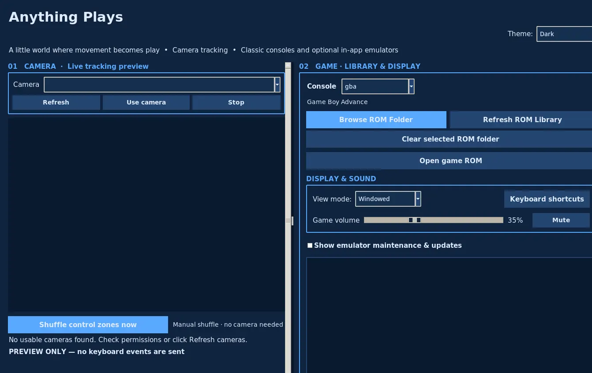
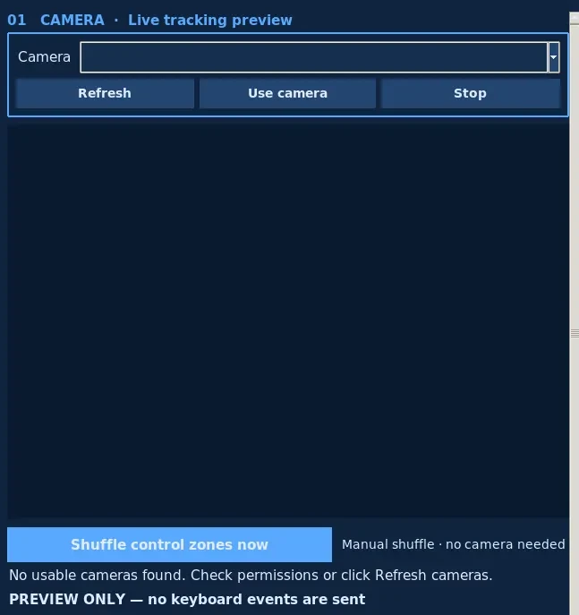
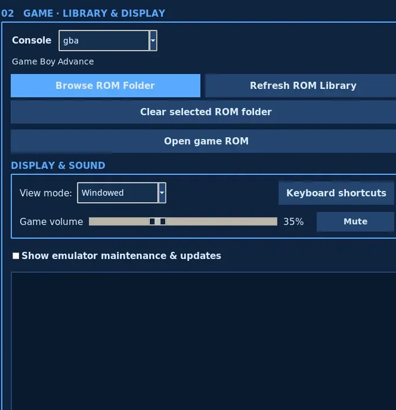

<div align="center">


# Anything Plays

**If it moves, it plays.**

A camera-powered desktop gaming studio that turns real-world movement into controls for classic games.

**18 console profiles · 11 embedded emulator cores · Windows, macOS and Linux**

[**Portfolio website**](https://anythingplays.masynnay.com/) · [**Download 3.0**](https://github.com/MasynNay/anything-plays/releases/tag/v3.0.0) · [Screenshots](#screenshots) · [Features](#features) · [Get started](#get-started) · [Roadmap](ROADMAP.md) · [Source and licenses](#source-and-licenses)

</div>

---

## Your world is the controller

Anything Plays makes a different kind of game controller possible. Point a webcam at a colorful object—a toy, your hand, or even a fish—and map the places it moves to the buttons on your favorite games.

Customize the control zones, choose a console, and play in the same desktop application. Don't have a camera handy? Keyboard controls work too.

**Version 3.0 is now publicly available** with Nintendo 64, GameCube, and 16 more console profiles. The four platform installers contain the native emulator cores; you don't have to install RetroArch or Dolphin separately.

## Screenshots

These are captures of the **real packaged Anything Plays 3.0 Linux desktop application**, not concept art, a browser mockup, or generated gameplay. The original capture was made with no webcam connected and no commercial ROM loaded.

### The desktop studio

The camera tracking panel, console selector, ROM library controls, audio volume, and display preferences share one window.

[](site/assets/anything-plays-desktop-preview.webp)

<sub>Actual packaged app UI · Linux capture · [See the portfolio experience](https://anythingplays.masynnay.com/#desktop)</sub>

### A closer look at the controls

<table>
  <tr>
    <td width="50%" align="center"><a href="docs/screenshots/current/camera-controls.webp"></a></td>
    <td width="50%" align="center"><a href="docs/screenshots/current/game-library-and-audio.webp"></a></td>
  </tr>
  <tr>
    <td align="center"><sub>Camera studio · Select a device, preview tracking, and shuffle control zones</sub></td>
    <td align="center"><sub>Game library · Pick a console, browse games, and adjust display and sound</sub></td>
  </tr>
</table>

<sub>Screenshot provenance: These two close-ups are reproducible **crops of the full real application screenshot**, not screenshots of different gameplay sessions. See the [capture script](tools/prepare_readme_screenshots.py) and [screenshot verification workflow](.github/workflows/readme-screenshots.yml). No game ROMs or private camera footage are included.</sub>

## Features

- **Anything can be a controller.** Track a chosen object color with OpenCV and map movement through on-screen zones to game inputs.
- **Make the layout yours.** Position, size, shuffle, and remap controls. Tune button labels, save console-specific preferences, and use keyboard controls when you prefer.
- **18 console profiles in one place.** Choose from Nintendo, Sega, Atari, NEC, SNK, and Bandai platforms without switching to a separate emulator application.
- **Embedded local play.** The desktop app includes 11 native Libretro cores, including Dolphin for GameCube and ParaLLEl-N64 for Nintendo 64.
- **Organized game libraries.** Browse your local folders with a ROM shelf and keep library locations associated with each console.
- **Video and audio controls.** Adjust game volume, mute, switch display modes, and use console-specific input mappings.
- **Local-first design.** Camera processing and gameplay run on your computer. No account or hosted service is required for normal local use.
- **Reproducible four-platform releases.** GitHub Actions builds, tests, and packages the application for Windows, Linux, Apple Silicon, and Intel Mac.

## Console support

| Family | Supported systems |
| --- | --- |
| **Nintendo handhelds** | Game Boy, Game Boy Color, Game Boy Advance |
| **Nintendo home consoles** | NES, Super Nintendo, Nintendo 64, GameCube |
| **Sega** | Genesis / Mega Drive, Master System, Game Gear, SG-1000 |
| **Atari** | Atari 2600, Atari 7800 |
| **NEC** | TurboGrafx-16 / PC Engine (HuCard) |
| **SNK** | Neo Geo Pocket, Neo Geo Pocket Color |
| **Bandai** | WonderSwan, WonderSwan Color |

The bundled 3.0 cores are **mGBA, Supafaust, FCEUmm, BlastEm, ParaLLEl-N64, Dolphin, Tia, ProSystem, Beetle PCE Fast, NeoPop, and Beetle WonderSwan**.

Emulator compatibility varies with the title and hardware. Anything Plays does **not** include commercial game files or proprietary BIOS images. Supply only ROMs or firmware you are legally entitled to use.

## Get started

### Download the application

**[Download Anything Plays 3.0.0 for your computer](https://github.com/MasynNay/anything-plays/releases/tag/v3.0.0)**

| Platform | Official 3.0 installer |
| --- | --- |
| **Windows 64-bit** | [AnythingPlaysSetup-3.0.0.exe](https://github.com/MasynNay/anything-plays/releases/download/v3.0.0/AnythingPlaysSetup-3.0.0.exe) |
| **macOS Apple Silicon** | [AnythingPlays-3.0.0-macos-arm64.dmg](https://github.com/MasynNay/anything-plays/releases/download/v3.0.0/AnythingPlays-3.0.0-macos-arm64.dmg) |
| **macOS Intel** | [AnythingPlays-3.0.0-macos-x64.dmg](https://github.com/MasynNay/anything-plays/releases/download/v3.0.0/AnythingPlays-3.0.0-macos-x64.dmg) |
| **Ubuntu / Debian 64-bit** | [anything-plays_3.0.0_amd64.deb](https://github.com/MasynNay/anything-plays/releases/download/v3.0.0/anything-plays_3.0.0_amd64.deb) |

After installing, open Anything Plays, select your console and local ROM directory, then choose your preferred camera or keyboard control setup. A webcam is optional.

**Verify your download:** [SHA256SUMS.txt](https://github.com/MasynNay/anything-plays/releases/download/v3.0.0/SHA256SUMS.txt). Windows builds may be unsigned and macOS apps use ad hoc signatures rather than Apple notarization, so your operating system may display a security warning. Verify the release and checksum before proceeding.

[Latest public release](https://github.com/MasynNay/anything-plays/releases/latest) · [Previous stable 2.0](https://github.com/MasynNay/anything-plays/releases/tag/v2.0.0) · [Original emulator sources for 3.0](https://github.com/MasynNay/anything-plays/releases/tag/v3.0.0-sources) · [All releases](https://github.com/MasynNay/anything-plays/releases)

### Run from source

You'll need **Python 3.12 or 3.13**, Tkinter, and the dependencies listed in the repository. For a local development environment:

```bash
python -m venv .venv
# Activate .venv using the appropriate command for your operating system.
python -m pip install -r requirements.txt
python app.py
```

The Git repository contains the application and build tools, but native emulator libraries are intentionally not checked into Git. For a ready-to-play offline package, use the downloadable installers above.

## How it works

```text
Webcam or keyboard
        |
        v
 OpenCV color tracking  --->  Adjustable control zones
                                       |
                                       v
                              Libretro input mapping
                                       |
                                       v
                Embedded emulator selected by console
                                       |
                                       v
                         Local video, audio and saves
```

The Python/Tkinter UI manages cameras, game libraries, themes, layouts, and preferences. OpenCV recognizes selected colors in camera frames. Each active Libretro core receives local input callbacks while its video and audio appear inside the application. Core lifecycle and saved game handling are separated into focused modules.

For deeper implementation details, read [Architecture](docs/ARCHITECTURE.md) and the [technical documentation index](docs/README.md).

## Repository structure

```text
anything-plays/
├── .github/workflows/    Tests, original-source verification and release automation
├── anything_plays/       Camera UI, console profiles, emulator sessions and saves
├── assets/               Original artwork and desktop application assets
├── config/               Auditable release inputs and settings
├── docs/                 Architecture, QA, provenance and screenshots
│   └── screenshots/      Verified real desktop UI detail captures
├── licenses/             Third-party notices and license reference material
├── packaging/            Windows, macOS and Linux installer builders
├── site/                 Static portfolio website at anythingplays.masynnay.com
├── tests/                Python, UI and release regression tests
├── tools/                Build, validation and screenshot capture helpers
├── app.py                Desktop application entry point
├── README.md             Project introduction
└── ROADMAP.md            Public development milestones
```

The original application source is separate from generated installers, native binaries, and personal game libraries. CI and packaging helpers are organized by responsibility rather than bundled into the README.

## Development and testing

Anything Plays 3.0 has verified original-source builds on **Windows x64, Linux x64, macOS Apple Silicon, and macOS Intel**. Its release checks exercise native core identity, packaged GUI startup, original homebrew graphics/audio, repeated game-session switching, and source archive correspondence.

[View the successful four-platform build](https://github.com/MasynNay/anything-plays/actions/runs/42718569352) · [View the publication run](https://github.com/MasynNay/anything-plays/actions/runs/42724633466) · [Browse source and native checks](docs/V3_0_EXACT_RUNTIME_LICENSE_SCOPE.md)

Run regression tests locally:

```bash
python -m unittest discover -s tests -p "test_*.py" -v
```

Actual retail-game, camera, GPU, save compatibility, and very long sessions vary by computer and aren't all exhaustively tested. Please report reproducible issues with the relevant console and operating system, without uploading copyrighted ROMs or personal camera footage.

## Roadmap

3.0 is a **shipped milestone**, not a roadmap promise. Active work now focuses on GameCube performance, camera calibration, save reliability, long-session stability, and better platform diagnostics.

[**Read the development roadmap**](ROADMAP.md) · [Open issues](https://github.com/MasynNay/anything-plays/issues) · [Contributing](CONTRIBUTING.md)

## Portfolio website

The public [Anything Plays portfolio](https://anythingplays.masynnay.com/) showcases the original artwork, a real desktop capture, an interactive camera-zone *concept*, the engineering approach, and the development roadmap. The browser concept is illustrative; **the playable emulator is the downloadable desktop application**, not a hosted web game.

## Source and licenses

The Anything Plays application source is published under the [MIT License](LICENSE). Embedded emulator cores and other libraries retain their own upstream copyright and license terms. The corresponding original emulator source trees and checksums are available in the [3.0 source companion release](https://github.com/MasynNay/anything-plays/releases/tag/v3.0.0-sources).

For exact compiled-source provenance, third-party licensing scope and known limitations, see [Original-source audit](docs/V3_0_EXACT_RUNTIME_LICENSE_SCOPE.md) and [Source-first release assessment](docs/V3_0_SOURCE_FIRST_RELEASE_DECISION.md).

Anything Plays is an independent open-source portfolio project and is not affiliated with the console manufacturers or emulator teams.
