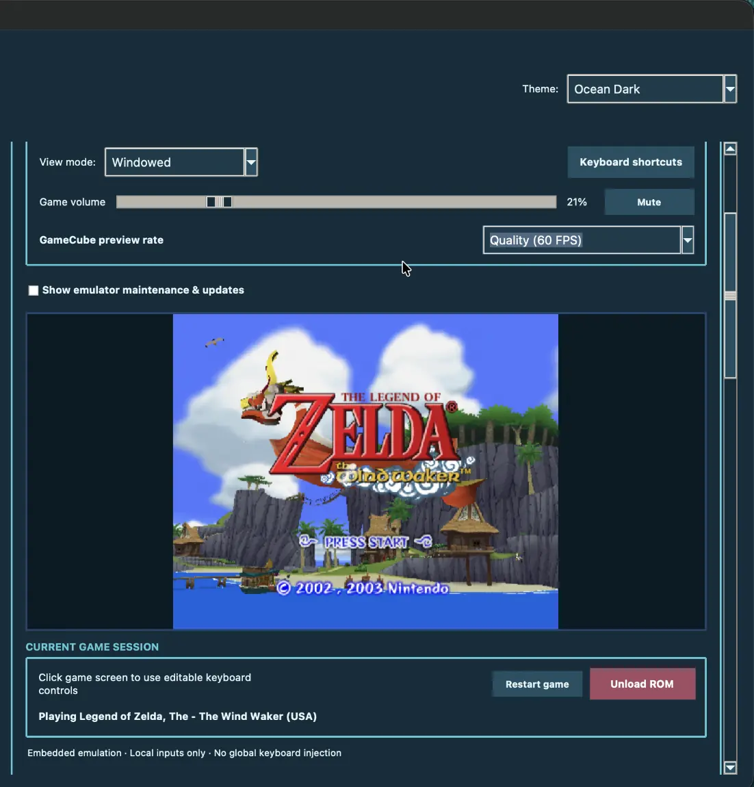
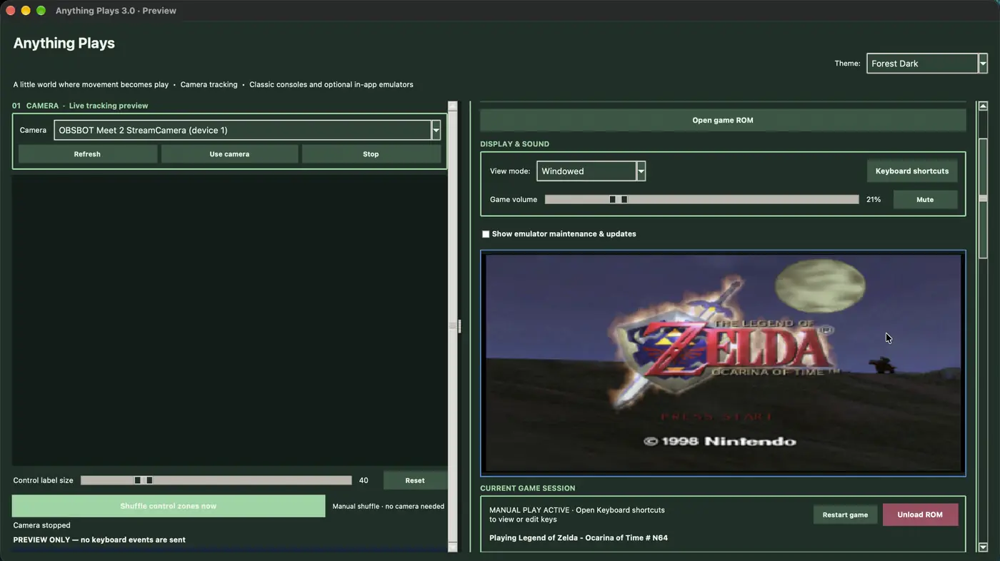
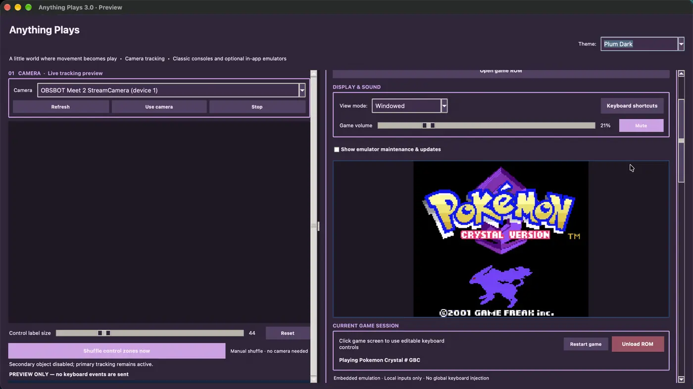
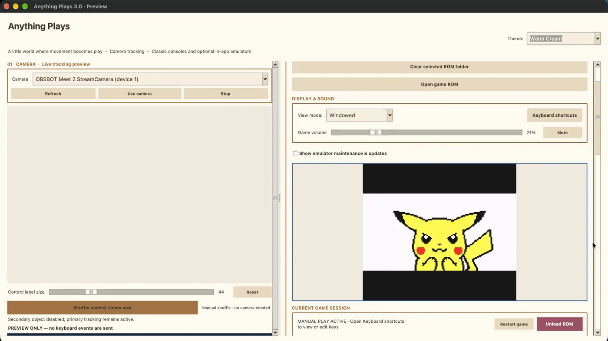
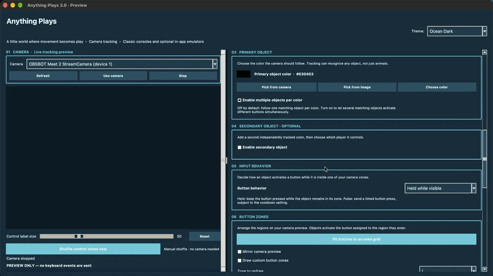
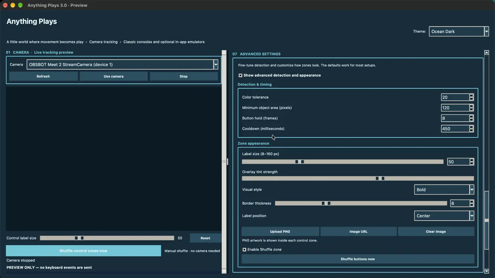
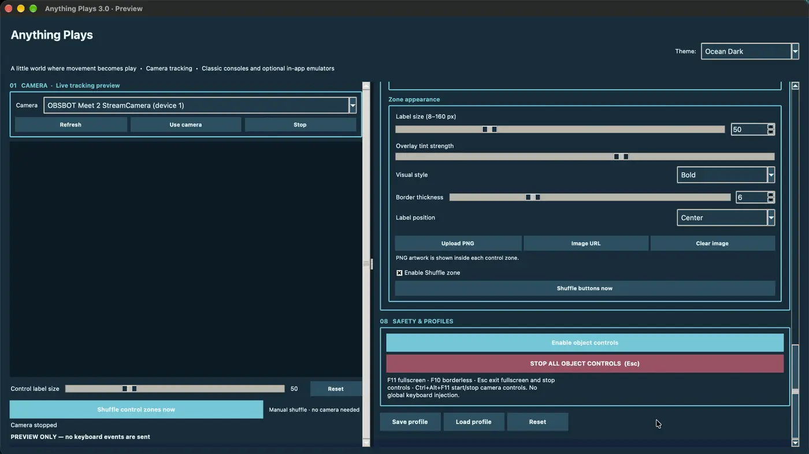

<div align="center">

<a href="https://anythingplays.masynnay.com/"></a>

# Anything Plays

**If it moves, it plays.**

A camera-powered desktop app that turns real-world movement into controls for classic games.

**18 console profiles · 11 native emulator cores · Windows, macOS and Linux**

[Official website](https://anythingplays.masynnay.com/) · [Download stable 3.1.1](https://github.com/MasynNay/anything-plays/releases/tag/v3.1.1) · [Previous 3.1.0](https://github.com/MasynNay/anything-plays/releases/tag/v3.1.0) · [Screenshots](#screenshots) · [Features](#features) · [Get started](#get-started) · [How it works](#how-it-works) · [Roadmap](docs/ROADMAP.md) · [Open issues](https://github.com/MasynNay/anything-plays/issues)

</div>

---

## Anything Plays 3.1.1 — public stable maintenance release

**[Download the official Anything Plays 3.1.1 release for Windows, Linux and both Macs](https://github.com/MasynNay/anything-plays/releases/tag/v3.1.1)**

**3.1.1 reliability improvements:** safer camera reconnect/disconnect, resilient controller enumeration and SDL recovery, atomic game save writes and Windows sharing-conflict retries, plus ROM/art library fault isolation. Four native platform builds, complete 18-console installers and real frozen Tk/Stream Mode startup passed in [release QA](https://github.com/MasynNay/anything-plays/actions/runs/43355665931). The update retains the 3.1 installation identity and settings. [Read 3.1.1 maintenance notes](docs/releases/ANYTHING_PLAYS_V3_1_1_PUBLIC_NOTES.md).

**New in 3.1: customizable Stream Mode and optional controller support.** One resizable, Nintendo DS-inspired window displays the current game beside the annotated camera for OBS Window Capture. Separate controls adjust stacked or side-by-side screens, 16 themes, customizable bezels, proportions and 15/24/30 FPS display presets. 3.1 also adds per-console gamepad mapping, a controller tester, improved reconnect/focus safety, and isolated settings. [Learn about Stream Mode](docs/V3_1_STREAM_MODE.md).

All four complete installers ship the same **18 console profiles and 11 original-source emulator core families** as stable 3.1.0. The [same-source four-platform 3.1.1 native builds, full 18-console packages, installed desktop tests and eight-asset private review passed](https://github.com/MasynNay/anything-plays/actions/runs/43355665931), and the [release's eight assets](https://github.com/MasynNay/anything-plays/releases/tag/v3.1.1) include original pygame/SDL/mpg123 sources, SHA256 checksums, source access notes, and the build manifest.

**Hardware scope:** these tests do not certify connected real controllers, webcams, retail-game save/audio behavior or multi-hour sessions on every platform. See [3.1.1 QA limitations](docs/releases/ANYTHING_PLAYS_V3_1_1_PUBLIC_NOTES.md). The complete installer is free for noncommercial use, with separately licensed emulator cores and runtime dependencies. [Original LGPL source and rebuild instructions](docs/V3_1_LGPL_REBUILD_REPLACEMENT.md) are available. Stable 3.1.0, stable 3.0 and public 3.1 RC2 remain accessible as earlier downloads.

## Screenshots

The screenshots below come from the actual Anything Plays 3.0 macOS application. The macOS menu bar and Dock have been cropped out. The GameCube capture shows the game panel rather than private camera footage. Click any image to view the larger capture.

### Real gameplay across consoles

<table>
  <tr>
    <td width="50%" align="center" valign="top">
      <a href="docs/screenshots/3.0/gamecube-wind-waker.webp"></a>
      <sub>GameCube · The Wind Waker · Ocean Dark</sub>
    </td>
    <td width="50%" align="center" valign="top">
      <a href="docs/screenshots/3.0/n64-ocarina.webp"></a>
      <sub>Nintendo 64 · Ocarina of Time · Forest Dark</sub>
      <br>
      <a href="docs/screenshots/3.0/gbc-pokemon-crystal.webp"></a>
      <sub>Game Boy Color · Pokémon Crystal · Plum Dark</sub>
    </td>
  </tr>
</table>

<p align="center">
  <a href="docs/screenshots/3.0/gba-warm-cream.webp"></a>
  <br><sub>Game Boy Advance · Warm Cream</sub>
</p>

### Camera controls and customization

<table>
  <tr>
    <td width="50%" align="center">
      <a href="docs/screenshots/3.0/camera-object-settings.webp"></a>
      <sub>Camera tracking, multiple objects and button zones</sub>
    </td>
    <td width="50%" align="center">
      <a href="docs/screenshots/3.0/advanced-settings.webp"></a>
      <sub>Advanced detection and zone appearance</sub>
    </td>
  </tr>
</table>

<p align="center">
  <a href="docs/screenshots/3.0/safety-and-profiles.webp"></a>
  <br><sub>Input safety and saved profiles</sub>
</p>

## Play a game. Let something else hold the controller.

Anything Plays uses your webcam to follow a selected color and translate movement into gamepad inputs. Set up control zones, choose an object to track, and let a fish, a toy, your hand, or anything else move through those zones to play a game.

The controls are sent directly to the embedded emulator, **not injected as system-wide keyboard events**. You can also click the game display and play with a keyboard. A webcam is optional.

**Version 3.0 introduced** 18 console profiles into one desktop application, including Nintendo 64 and GameCube, with local ROM libraries, saved control layouts, embedded video and audio, and bundled native emulator cores.

> **Official product site:** [anythingplays.masynnay.com](https://anythingplays.masynnay.com/) showcases the design and engineering. The playable experience is the **downloadable desktop app**, not a hosted browser emulator. Anything Plays remains free of charge.

## What's new in 3.0

- **More systems.** Expanded from the four original 2.0 systems to 18 console profiles, powered by 11 native Libretro cores.
- **Nintendo 64 and GameCube.** Play through embedded ParaLLEl-N64 and Dolphin integrations, with compatibility dependent on the game and computer.
- **Unified game library.** Keep separate ROM directories and control profiles for each console, with a visual game shelf.
- **More flexible camera input.** Arrange, resize, reset, shuffle, and remap tracking zones. Adjust control label size to fit your layout.
- **Themes, audio and display controls.** Customize the studio appearance, adjust game volume and mute, and select game display options.
- **Four desktop installers.** Windows x64, Ubuntu/Debian Linux x64, macOS Apple Silicon, and macOS Intel. Official packages include the supported cores.

The original **2.0 release is preserved** for anyone who prefers the earlier four-console edition.

## Features

- **Anything can be a controller.** Choose a target color from your camera and use the tracked object's position to trigger game inputs.
- **Stream Mode (3.1 stable).** Capture the game and annotated camera together in a DS-inspired, customizable output window without including its separate controls in your OBS stream.
- **Optional gamepad controls (3.1).** Configure console-specific controller mappings with a live tester and gamepad status feedback; hardware compatibility varies.
- **Customizable layouts.** Configure button zones and mappings, keep them balanced or place them manually, and adjust the labels displayed over video.
- **Console-specific profiles.** Retain the right library folders and input preferences when switching systems.
- **Visual ROM browsing.** Navigate locally stored games through a console-specific shelf.
- **Keyboard play.** Use the embedded emulator without connecting a webcam.
- **Local video, audio and saves.** Run gameplay and camera processing on your computer, without an account or hosted service.
- **Cross-platform packaging.** Install the complete application without separately setting up RetroArch or Dolphin.

## Supported consoles

| Family | Supported systems | Native core |
| :-- | :-- | :-- |
| Nintendo handhelds | Game Boy, Game Boy Color, Game Boy Advance | mGBA |
| Nintendo home consoles | NES, Super Nintendo | FCEUmm, Supafaust |
| Nintendo 64 | Nintendo 64 | ParaLLEl-N64 |
| Nintendo GameCube | GameCube | Dolphin |
| Sega | Genesis / Mega Drive, Master System, Game Gear, SG-1000 | BlastEm |
| Atari | Atari 2600, Atari 7800 | Tia, ProSystem |
| NEC | TurboGrafx-16 / PC Engine | Beetle PCE Fast |
| SNK | Neo Geo Pocket, Neo Geo Pocket Color | NeoPop |
| Bandai | WonderSwan, WonderSwan Color | Beetle WonderSwan |

The chosen console determines the matching emulator automatically. **No commercial ROMs or proprietary BIOS files are included.** Use only game files and firmware you are legally entitled to use. Hardware performance and game compatibility vary.

## Portfolio experience

The [Anything Plays website](https://anythingplays.masynnay.com/) introduces the project, original betta fish artwork, camera-control concept, development roadmap, and technical implementation. Its interactive grid explains how tracking zones work; it is a demonstration of the idea, **not live webcam gameplay or a browser version of the application**.

The desktop software is built with Python, Tkinter, OpenCV, NumPy and native Libretro integrations. The static portfolio is served separately from the `site/` directory using GitHub Pages.

## Get started

### Download the desktop app

**[Anything Plays 3.1.1 — latest stable GitHub release](https://github.com/MasynNay/anything-plays/releases/tag/v3.1.1)**

| Computer | Official 3.1.1 installer |
| :-- | :-- |
| Windows 10/11 x64 | [AnythingPlaysSetup-3.1.1.exe](https://github.com/MasynNay/anything-plays/releases/download/v3.1.1/AnythingPlaysSetup-3.1.1.exe) |
| Mac with Apple Silicon | [AnythingPlays-3.1.1-macos-arm64.dmg](https://github.com/MasynNay/anything-plays/releases/download/v3.1.1/AnythingPlays-3.1.1-macos-arm64.dmg) |
| Mac with Intel | [AnythingPlays-3.1.1-macos-x64.dmg](https://github.com/MasynNay/anything-plays/releases/download/v3.1.1/AnythingPlays-3.1.1-macos-x64.dmg) |
| Ubuntu / Debian Linux x64 | [anything-plays-31_3.1.1_amd64.deb](https://github.com/MasynNay/anything-plays/releases/download/v3.1.1/anything-plays-31_3.1.1_amd64.deb) |

Download **one** installer for your computer. Verify it with the [3.1.1 SHA256SUMS.txt](https://github.com/MasynNay/anything-plays/releases/download/v3.1.1/SHA256SUMS.txt). The same release includes the [original, unchanged 3.1.0 controller-runtime source ZIP](https://github.com/MasynNay/anything-plays/releases/download/v3.1.1/AnythingPlays-3.1.0-PYGAME-SDL-MPG123-ORIGINAL-SOURCE.zip) and [native library replacement guide](docs/V3_1_LGPL_REBUILD_REPLACEMENT.md).

**Windows:** Run the setup program. SmartScreen may display a warning because the installer is not commercially signed.

**macOS:** Open the DMG and copy the app into Applications. The app is ad hoc signed, not Apple-notarized, so macOS may request approval in System Settings → Privacy & Security.

**Linux:** Install the DEB with your package manager or run `sudo apt install ./anything-plays-31_3.1.1_amd64.deb` from its downloaded folder.

**Previous versions:** [stable 3.1.0](https://github.com/MasynNay/anything-plays/releases/tag/v3.1.0), [stable 3.0](https://github.com/MasynNay/anything-plays/releases/tag/v3.0.0) and [3.1 RC2](https://github.com/MasynNay/anything-plays/releases/tag/v3.1.0-rc2) remain available for rollback.

### Your first five minutes

1. Select a console and choose a folder containing compatible game files.
2. Pick a title from the ROM shelf.
3. Click the game display for keyboard play, or select a webcam and target color.
4. Arrange your control zones, assign buttons and adjust the label size.
5. Start playing and customize the theme, audio and display settings.

Bright, even lighting and a distinctive target color usually make camera tracking more reliable.

### Run from source

Use **Python 3.12 or 3.13**, Tkinter and the dependencies listed in the repository.

```bash
python -m venv .venv
# Activate .venv for your operating system.
python -m pip install -r requirements.txt
python app.py
```

Native core binaries are not stored directly in the Git repository. For an installed, ready-to-use offline application, use the official packages. Developers can follow the [technical documentation](docs/README.md).

## How it works

```text
Webcam → OpenCV color tracking → Custom control zones ─┐
                                                     │
Keyboard → Manual gamepad input ─────────────────────┤
                                                     ▼
Local ROM shelf → Console selection → Libretro session
                                          │
                                  Video · Audio · Saves
                                          │
                                    Tkinter desktop UI
```

Tkinter handles the application interface, camera preview and game library. OpenCV finds the selected colored object; the zone mapper turns its position into controller input. Dedicated emulator sessions handle native video and audio, core lifecycle, and game save operations.

For the engineering approach and module boundaries, see the [architecture guide](docs/ARCHITECTURE.md).

## Repository structure

```text
anything-plays/
├── anything_plays/       Desktop UI, tracking, profiles and emulator integrations
├── app.py                Application entry point
├── assets/               Original application icon and artwork
├── config/               Verified core and release inputs
├── docs/                 Architecture, release evidence and technical guides
├── licenses/             Third-party notices and licensing information
├── packaging/            Windows, Mac and Linux installer builders
├── site/                 GitHub Pages portfolio website
├── tests/                Unit, integration and native checks
├── tools/                Build and verification helpers
├── .github/workflows/    CI and release automation
├── docs/ROADMAP.md       Current development roadmap
└── README.md             Project overview
```

## Development roadmap

Anything Plays is actively maintained. The [public roadmap](docs/ROADMAP.md) separates released functionality from ongoing reliability work and future proposals.

**Current priorities:** GameCube GPU performance and long-session stability, more camera and save compatibility testing, and better setup diagnostics. Planned work includes easier camera calibration and portable control profiles.

[Read the roadmap](docs/ROADMAP.md) · [Browse development issues](https://github.com/MasynNay/anything-plays/issues)

## Development and testing

```bash
python -m unittest discover -s tests -p "test_*.py" -v
```

The source includes automated tests and four-platform release checks. The [verified 3.1 stable build](https://github.com/MasynNay/anything-plays/actions/runs/43140637755) covers packaged startup and selected emulator behavior. This is **not** a claim of compatibility with every retail game, webcam, GPU or extended session.

See [technical documentation](docs/README.md), [contributing](.github/CONTRIBUTING.md), and the [security policy](.github/SECURITY.md). If you encounter an issue, include your OS, console, expected behavior, and steps to reproduce, without uploading copyrighted game files or private camera footage.

## Technology

- **Desktop UI:** Python and Tkinter
- **Computer vision:** OpenCV and NumPy
- **Emulation:** Libretro native cores, including Dolphin and ParaLLEl-N64
- **Builds and testing:** PyInstaller, platform packaging scripts and GitHub Actions
- **Portfolio hosting:** GitHub Pages

## License and project notes

Anything Plays is distributed **free of charge**, with no advertisements, subscriptions or paid features.

The original Anything Plays source code is [MIT licensed](LICENSE). Third-party emulator cores and libraries retain their respective licenses. Their original sources and checksums are provided in the [3.0 source companion release](https://github.com/MasynNay/anything-plays/releases/tag/v3.0.0-sources); see the [source and license audit](docs/V3_0_EXACT_RUNTIME_LICENSE_SCOPE.md). The original betta fish artwork is separately rights-controlled.

This independent portfolio project is not endorsed by or affiliated with the console manufacturers or emulator developers.
